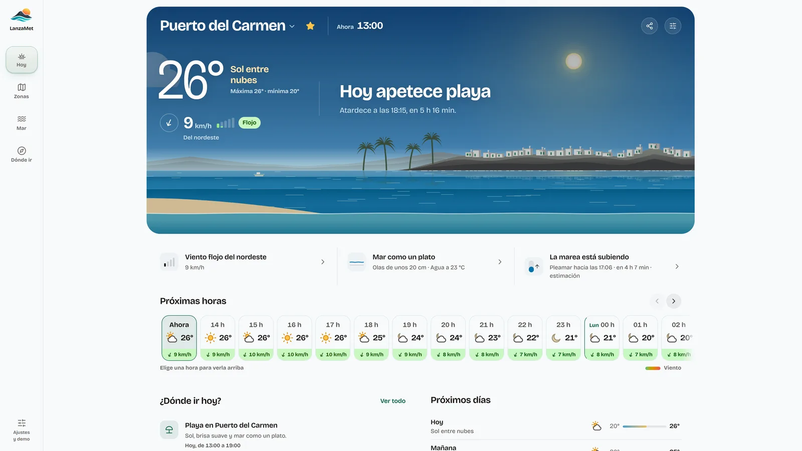
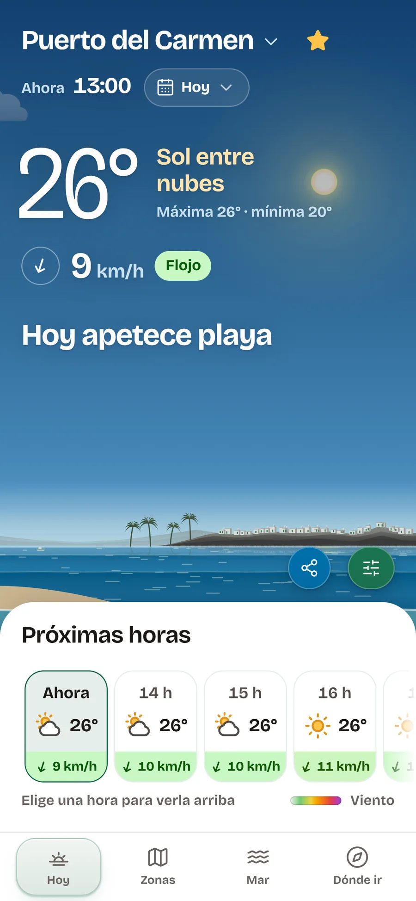
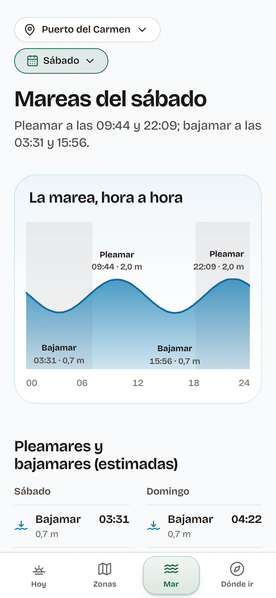
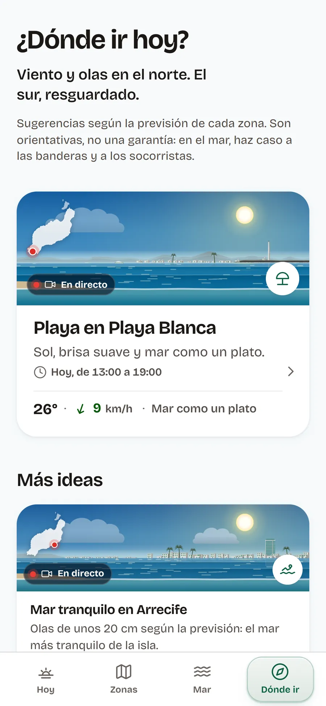
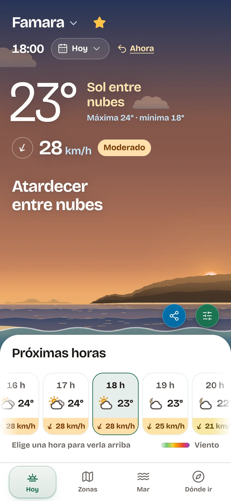
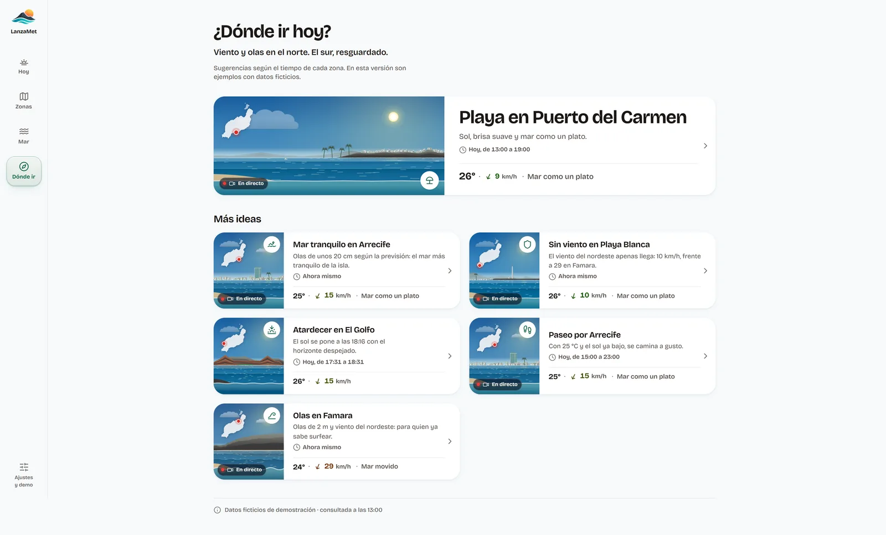
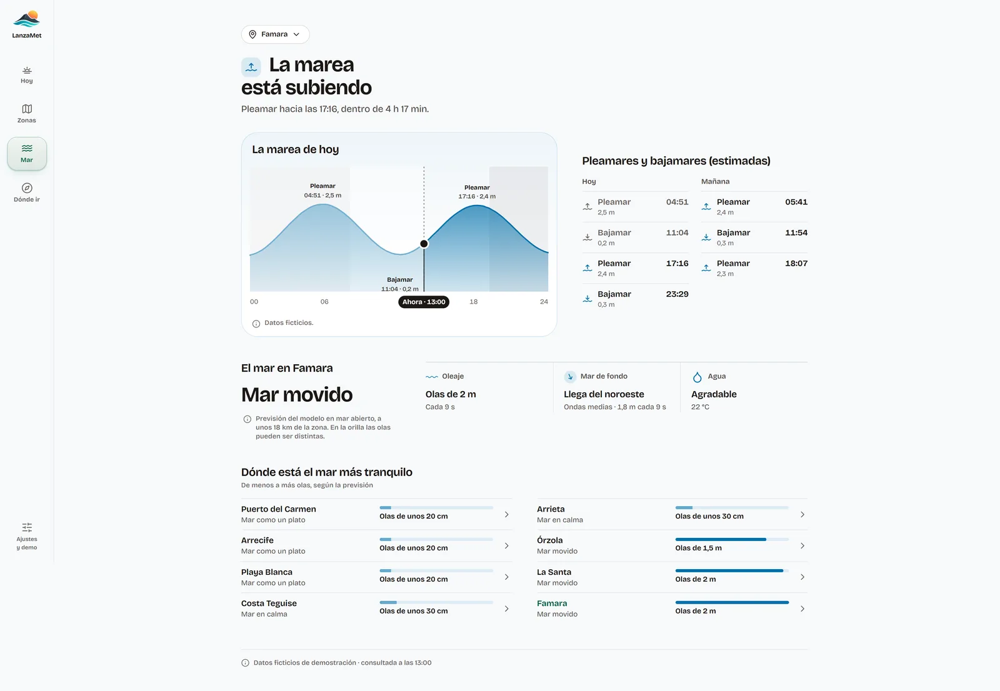
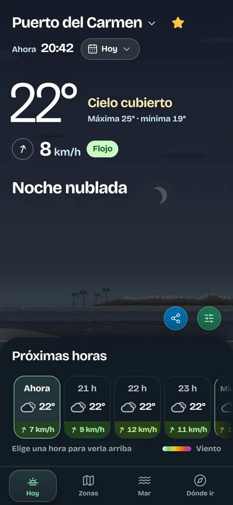
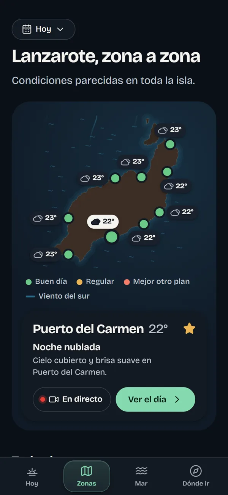

<div align="center">


# LanzaMet

### El tiempo y el mar de Lanzarote, en palabras claras

**Producto propio · En producción desde octubre de 2026 · Gratuito y sin publicidad**


[](#estado-del-proyecto)
[](https://lanzamet.com)
[](https://github.com/fmoorenoo/LanzaMet)

**[Abrir lanzamet.com](https://lanzamet.com)**

</div>

---

<div align="center">
  
</div>

## Sobre el proyecto

**LanzaMet** es una web para entender en tres segundos cómo está el día en **Lanzarote**: tiempo, viento, mar, mareas y a qué zona ir. Cubre **9 zonas de la isla**, funciona en **español e inglés** y se puede instalar en el móvil o en el ordenador como una app.

Es un **producto propio**: la idea, el diseño y el desarrollo son míos, de principio a fin. Combina datos reales de **Open-Meteo** y avisos oficiales de **AEMET**, y los traduce a frases claras como «Hoy apetece playa» o «Viento flojo del nordeste», en lugar de tablas de números.

> La marea es una **estimación** a partir de un modelo oceánico, y la web lo dice siempre. No sirve para navegar ni sustituye a los avisos oficiales.

## Funcionalidades

- **Hoy:** escena atmosférica dibujada a partir de los datos (cielo, nubes, calima, lluvia, sol o luna, olas y nivel de la marea), con temperatura, viento y un veredicto del día.
- **Próximas horas y 7 días:** previsión hora a hora con el viento de cada hora en color, y vista de la semana.
- **Zonas:** mapa ilustrado de la isla con el estado de cada zona y tarjetas con miniescena.
- **Mar:** curva de la marea del día, pleamares y bajamares, oleaje, mar de fondo y temperatura del agua.
- **Dónde ir:** recomendaciones según los datos (playa, sin viento, mar tranquilo, atardecer, paseo, olas).
- **Viento:** las 9 zonas ordenadas de menos a más viento, con las rachas de las próximas 24 horas.
- **Avisos oficiales de AEMET** y medidas reales de sus estaciones cuando hay una cerca.
- **Cámaras en directo** de la costa en las zonas que tienen una.
- **Instalable (PWA)** con guía paso a paso para cada móvil y navegador.
- **Widget para otras webs:** una tarjeta con el tiempo de una zona para alojamientos, escuelas o bares.
- **Bilingüe y accesible:** cada página tiene su dirección en cada idioma, y todo el movimiento respeta las preferencias de movimiento reducido.

## Tecnologías

| Área | Tecnologías |
| --- | --- |
| **Frontend** | Angular 22 · Signals · rxResource · TypeScript · SCSS |
| **Renderizado** | Prerenderizado estático con `@angular/ssr` · páginas por zona e idioma |
| **PWA** | `@angular/service-worker` · manifest e iconos propios |
| **API propia** | Cloudflare Workers · caché en dos niveles (memoria y Cache API) |
| **Datos** | Open-Meteo (tiempo, mar y polvo) · AEMET (avisos y observaciones) |
| **Formulario** | Web3Forms, con protección antispam |
| **Calidad** | Vitest · `node:test` · ESLint · Prettier |
| **Despliegue** | Cloudflare Workers · Wrangler · dominio propio con HTTPS |

Sin backend con base de datos ni cuentas de usuario: las preferencias se guardan en el propio dispositivo.

## Arquitectura

```text
LanzaMet/
├── src/app/
│   ├── core/
│   │   ├── data/        # Puertos de datos, zonas y adaptadores de Open-Meteo y AEMET
│   │   ├── insights/    # Reglas puras: datos → veredictos, frases y recomendaciones
│   │   ├── state/       # Stores con Signals
│   │   ├── i18n/        # Idiomas: diccionarios tipados y direcciones por idioma
│   │   ├── pwa/         # Instalación y service worker
│   │   └── seo/         # Títulos, canonical y datos estructurados
│   ├── features/        # Hoy · Zonas · Mar · Dónde ir · Viento · Widget · Sobre · Legal
│   ├── layout/          # Navegación, selector de zonas, ajustes e instalación
│   └── shared/          # Escena atmosférica, iconos y componentes comunes
├── server/              # API propia: AEMET, copia compartida de Open-Meteo y caché
├── scripts/             # Build de producción, imágenes para compartir y verificación de fuentes
└── docs/                # Documentación técnica, diseño y auditoría SEO
```

La lógica meteorológica vive en **reglas puras** (`core/insights`) que no escriben frases: devuelven descriptores que se traducen a cada idioma. Así hay una sola lógica para español e inglés, probada con tests que recorren decenas de miles de combinaciones de hora, cielo, viento y mar.

## Vista del proyecto

| Hoy | Mar | Dónde ir | Atardecer |
| :---: | :---: | :---: | :---: |
|  |  |  |  |

| Dónde ir en escritorio | Mareas en escritorio |
| :---: | :---: |
|  |  |

| La escena cambia con la hora | Zonas de noche |
| :---: | :---: |
|  |  |

Las capturas de día usan los datos de demostración del proyecto; las de noche son de la web publicada.

## Instalación y ejecución

Requisitos: **Node 24+** y npm.

```bash
git clone https://github.com/fmoorenoo/LanzaMet.git
cd LanzaMet
npm install

npm start            # web en http://localhost:4200
npm run api          # API propia en http://localhost:8787/api (opcional)
npm run start:demo   # web con datos simulados y escenarios ajustables

npm test             # tests de la web
npm run test:api     # tests de la API
npm run build        # build de producción en dist/
```

Sin la API propia, la web funciona igual con Open-Meteo; los avisos y las medidas de AEMET aparecen como no disponibles. Las observaciones de AEMET necesitan una clave gratuita, que solo se usa en el servidor.

**Documentación técnica completa:** fuentes de datos, caché, PWA, idiomas, SEO y despliegue en [`docs/DOCUMENTACION.md`](docs/DOCUMENTACION.md) y [`DEPLOYMENT.md`](DEPLOYMENT.md).

## Estado del proyecto

**En producción en [lanzamet.com](https://lanzamet.com) desde octubre de 2026**, publicado en Cloudflare con dominio propio, y en desarrollo activo.

Consideraciones importantes:

- **Mareas estimadas:** salen de un modelo oceánico, no de una tabla oficial. No sirven para navegar.
- **Oleaje de mar abierto:** se mide a unos kilómetros de cada zona y no describe la rompiente en la orilla.
- **Recomendaciones orientativas:** en el mar, siempre mandan las banderas y los socorristas.

## Autor

**Fernando Montelongo Moreno** · Full Stack Developer · DAM + DAW

[](https://github.com/fmoorenoo)
[](https://www.linkedin.com/in/fernando-montelongo/)
[](https://fer-m.dev)

---
